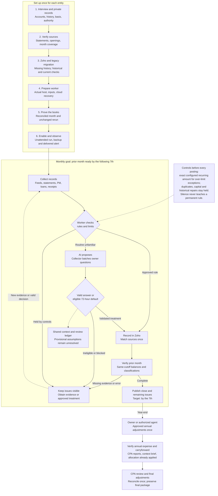

# AI bookkeeper flowchart

[Printable PDF](ai-bookkeeper-flowchart.pdf) | [Executive overview](EXECUTIVE_OVERVIEW.md) | [Implementation guide](IMPLEMENTATION_GUIDE.md)

The diagram is the combined operating plan. Collection, notification delivery and annual adjustments are agent/operator procedures; they require actual configured execution. Worker capability limits are in the implementation guide.

